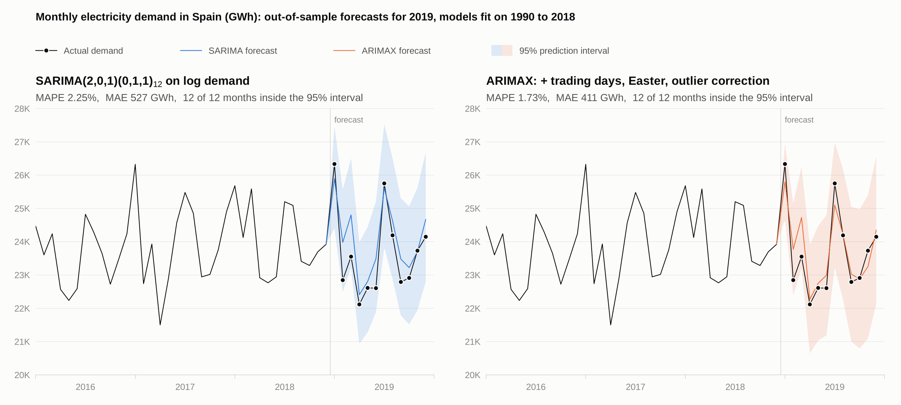

# Forecasting Spanish electricity demand with SARIMA and ARIMAX models

A Box–Jenkins study of monthly electricity demand in Spain from 1990 to 2019. We stabilize the variance with a log transform, remove the yearly cycle with a seasonal difference, search 550 SARIMA specifications under a parameter budget, check the residuals, and then extend the best models to ARIMAX with trading-day and Easter regressors and automatic outlier correction. Every model is judged on a held-out year: fit on 1990–2018, then forecast the twelve months of 2019 with 95% prediction intervals.

Final project for the Time Series course of the Master's in Statistics and Operations Research at the Universitat Politècnica de Catalunya (UPC), Barcelona, spring 2025, by Adrian Scholl and Ludvig Bergstrand.

**Full report:** [Scholl_Bergstrand_2025_report.pdf](Scholl_Bergstrand_2025_report.pdf), 18 pages with all diagnostic plots and test results.



## Results

Forecasts for January to December 2019 from models fit on January 1990 to December 2018:

| Model | RMSE (GWh) | MAE (GWh) | MAPE | Months inside the 95% interval |
|---|---:|---:|---:|---:|
| SARIMA(2,0,1)(0,1,1)<sub>12</sub>, log demand | 646 | 527 | 2.25% | 12 of 12 |
| SARIMA(1,0,2)(0,1,1)<sub>12</sub>, log demand | 647 | 525 | 2.25% | 12 of 12 |
| ARIMAX (2,0,1)(0,1,1)<sub>12</sub> + calendar + outliers | **537** | **411** | **1.73%** | 12 of 12 |
| ARIMAX (1,0,2)(0,1,1)<sub>12</sub> + calendar + outliers | 558 | 423 | 1.77% | 12 of 12 |

- Calendar and outlier correction cut the error by about a fifth (MAE from 527 to 411 GWh for the first model).
- The plain SARIMA models over-forecast 2019 by about 425 GWh per month on average. With calendar and outlier correction, this bias shrinks to about 120 GWh.
- The 95% prediction intervals of all four models contain every observed month of 2019.
- Both calendar regressors are significant (z = 3.7 for trading days, z = −2.4 for Easter). The outlier search finds eight interventions: five level shifts and three transitory changes.

## Data

`ConsumElec.dat` holds the gross internal consumption of electrical energy in Spain in GWh per month, January 1990 to December 2019 (360 observations), from the Banco de España. Annual demand almost doubled from 150 TWh in 1990 to a peak of 291 TWh in 2008 and has stayed between 270 and 290 TWh since. Demand peaks twice a year, in January (heating) and in July (cooling).

## Method

1. **Identification** (`arima.Rmd`). The yearly variance grows with the yearly mean, so we model log demand. One seasonal difference (D = 1) gives the lowest variance; further seasonal or regular differences raise it again, so d = 0. The seasonally differenced log series has a significantly positive mean (about 2.2% growth per year, t-test p < 0.001), so the models include a constant.
2. **Model search.** We fit all 550 SARIMA(p,0,q)(P,1,Q)<sub>12</sub> models with p ≤ 4, q ≤ 10, P ≤ 3, Q ≤ 4 and p + q + P + Q ≤ 10, keep those whose coefficients are all significant (95% Wald intervals that exclude zero), and rank them by AIC and BIC. Of the 535 models that converge, 92 have only significant coefficients. SARIMA(2,0,1)(0,1,1)<sub>12</sub> ranks first and SARIMA(1,0,2)(0,1,1)<sub>12</sub> second by both AIC and BIC, so these two go forward.
3. **Validation.** For both candidates: residual plots; normality (Shapiro–Wilk, Anderson–Darling, Jarque–Bera); homoscedasticity (Breusch–Pagan, ACF of squared residuals); independence (Durbin–Watson, Ljung–Box); stationarity and invertibility from the roots of the AR and MA polynomials; ψ- and π-weights; sample against theoretical ACF and PACF.
4. **Forecast evaluation.** Refit on 1990–2018, forecast 2019, back-transform point forecasts and 95% intervals from the log scale, and compare RMSE, MAE, RMSPE and MAPE.
5. **ARIMAX** (`arimax.Rmd`). On the original scale, add a trading-day and an Easter regressor (`CalendarEffects.r`), search iteratively for additive outliers, level shifts and transitory changes (`atipics2.R`, critical value 2.8), linearize the series, refit, and repeat the 2019 evaluation with the detected level shifts added back to the forecasts. The final models also forecast 2020. Outliers are detected on the full series; all eight lie before 2019.

## Repository

| File | Contents |
|---|---|
| `arima.Rmd` | Identification, model search, validation and SARIMA forecasts |
| `arimax.Rmd` | Calendar effects, outlier correction and ARIMAX forecasts for 2019 and 2020 |
| `CalendarEffects.r` | Trading-day and Easter regressors |
| `atipics2.R` | Outlier detection and linearization |
| `ConsumElec.dat` | Monthly demand data |
| `figures/forecast_2019.R` | Recreates the figure above |
| `Scholl_Bergstrand_2025_report.pdf` | Course report (18 pages) |

## Running the code

You need R (tested with 4.3) and the packages dplyr, nortest, tseries, lmtest and chron.

```r
install.packages(c("dplyr", "nortest", "tseries", "lmtest", "chron", "rmarkdown"))
rmarkdown::render("arima.Rmd")   # the model search fits 550 models and takes about half an hour
rmarkdown::render("arimax.Rmd")
```

You can also open `arimax-electricity-spain.Rproj` in RStudio and knit the two notebooks. `Rscript figures/forecast_2019.R` recreates the figure.

## Authors

Adrian Scholl and Ludvig Bergstrand, Faculty of Mathematics and Statistics (FME), UPC. Laboratory professors: Lesly Acosta and Laura Marquès. The helper functions in `CalendarEffects.r` and `atipics2.R` come from the course materials.

## License

MIT, see [LICENSE](LICENSE).
